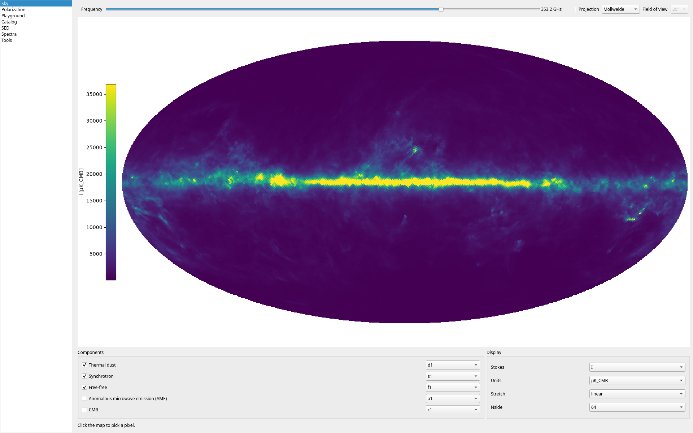
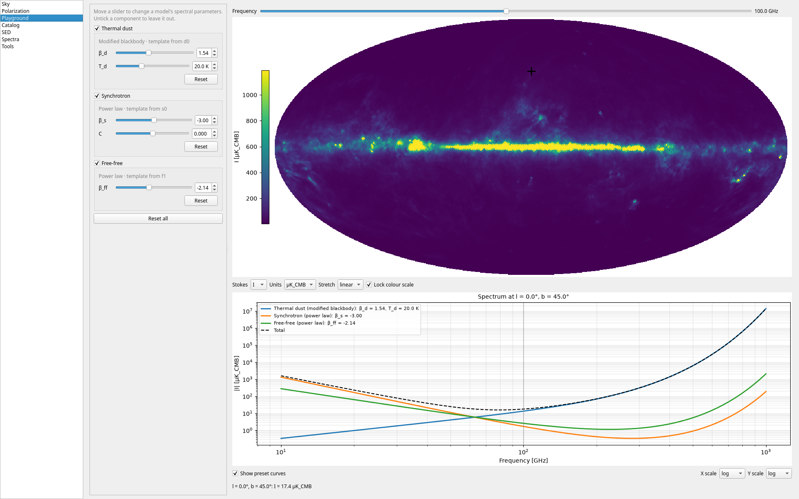
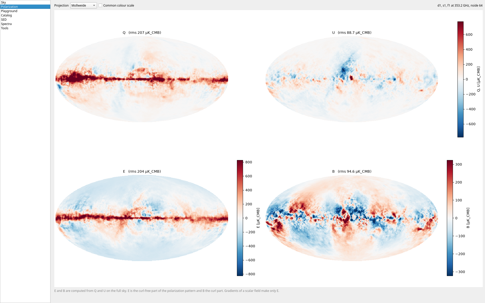
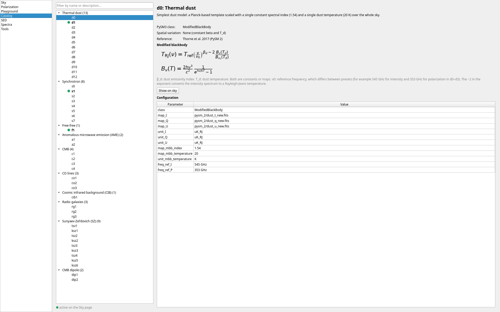
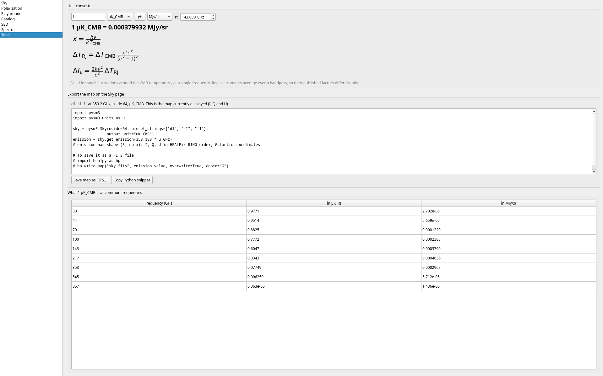

# pysm3i

An interactive Qt desktop app for exploring [PySM 3](https://github.com/galsci/pysm) Galactic foreground models for CMB experiments.

## Features

- **Model browser**: every PySM preset grouped by component (synchrotron, dust, free-free, AME, CMB, ...) with descriptions, references and rendered SED equations.
- **Sky maps**: I/Q/U in Mollweide, Cartesian and Orthographic projections, with a live frequency slider.
- **SED explorer**: click a pixel to plot emission versus frequency per component and in total, with instrument bands marked.
- **Component toggles**: switch components on and off and see each one's share of the total power.
- **Polarization**: E and B maps computed from Q and U on the full sky, shown beside Q and U. The "Common colour scale" option switches between one shared range and separate ranges (Q/U shared, E and B each their own).
- **Unit converter**: K_CMB, K_RJ and MJy/sr.
- **Resolution control**: low `nside` for interactivity, full resolution as a background job.

## Screenshots











See `TODO.md` for planned features.

## Requirements

- Python >= 3.13
- astropy, matplotlib, PyQt6, pysm3

## Installation

With [uv](https://docs.astral.sh/uv/):

```sh
git clone https://github.com/dheerajshenoy/pysm3i
cd pysm3i
uv sync
```

Or with pip:

```sh
pip install .
```

## Usage

```sh
uv run pysm3i
# or, if installed with pip
pysm3i
```

## Project layout

```
src/pysm3i/
  app.py      entry point
  core/       models, polarization and other computation
  gui/        Qt windows and pages
```

## Author

Dheeraj Vittal Shenoy
